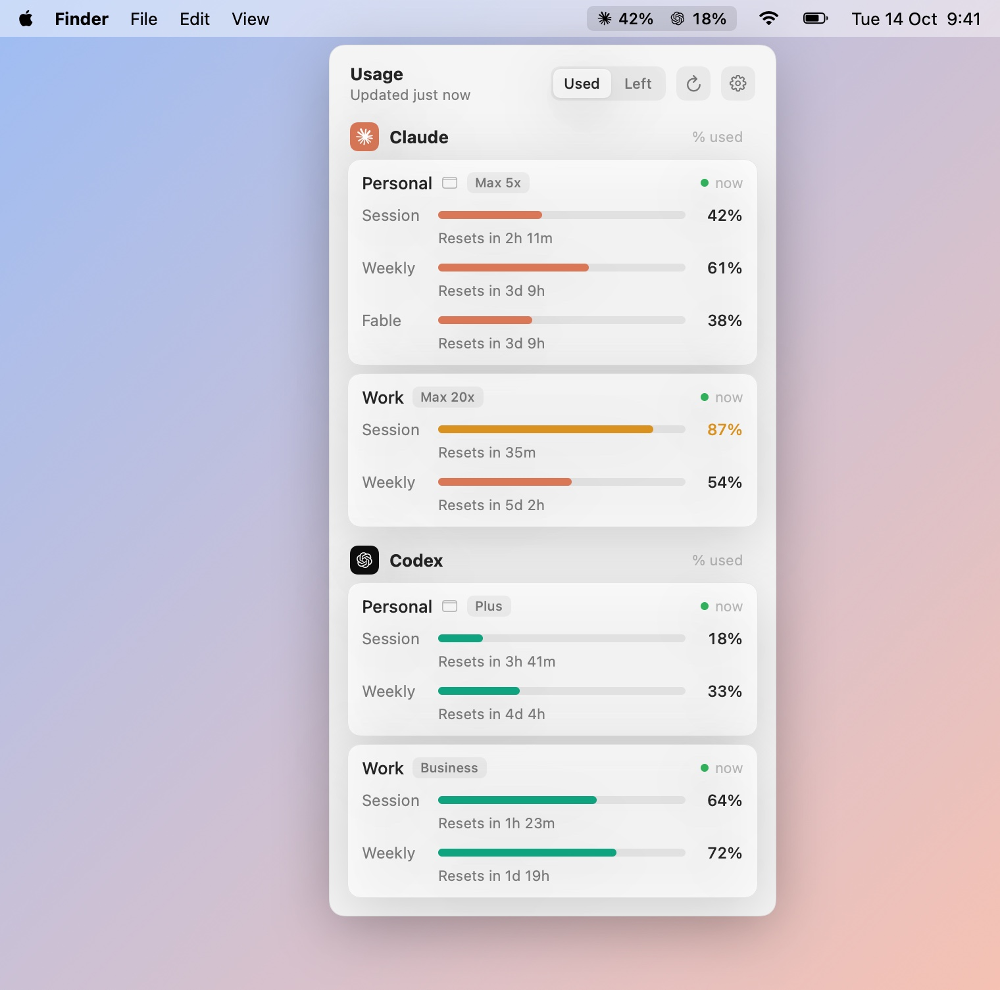

# Leeway

[](https://github.com/aliaks-ei/leeway/actions/workflows/ci.yml)
[](https://github.com/aliaks-ei/leeway/releases/latest)

[](LICENSE)

A macOS menu bar app that shows your **Claude Code** and **Codex** plan limits for every account signed in on your Mac.

<p align="center">
  <picture>
    <source media="(prefers-color-scheme: dark)" srcset="docs/images/hero-dark.jpg">
    
  </picture>
</p>

- Shows the 5-hour and weekly windows, with the time until each one resets.
- Finds every account by itself: `~/.claude`, `~/.codex` and folders such as `~/.claude-work`.
- Puts the account closest to its limit, or the accounts you choose, in the menu bar.
- Uses the logins you already have. There is no extra sign-in and no server of its own.

## Install

1. Download `Leeway-<version>.dmg` from the [latest release](https://github.com/aliaks-ei/leeway/releases/latest).
2. Open it, drag **Leeway** onto **Applications**, and open it from Applications.

Leeway needs macOS 15 or later, on Apple silicon or Intel.

> [!NOTE]
> Releases are not notarized by Apple yet. On the first launch, macOS blocks the app: open **System Settings → Privacy & Security**, scroll to "Leeway was blocked" and click **Open Anyway**. You do this once for each version.
>
> To make sure that you have the published file, compare `shasum -a 256 ~/Downloads/Leeway-*.dmg` with the SHA-256 on the release page.

### Build from source

You need Xcode 16 or later.

```bash
git clone https://github.com/aliaks-ei/leeway.git && cd leeway
```

```bash
./scripts/build-app.sh --install
```

```bash
open ~/Applications/Leeway.app
```

## Privacy

- Leeway reads the tokens that Claude Code and Codex already keep on your Mac, and sends them only to Anthropic and OpenAI to read your usage. See [Where the numbers come from](#where-the-numbers-come-from).
- It has no server, no analytics and no telemetry.
- It never logs or prints tokens, and it never refreshes a Claude token itself.
- "Check for Updates" connects to GitHub only when you click it.

## Accounts

The app finds the accounts by itself, on launch and on each refresh:

| Provider | Folders |
|---|---|
| Claude Code | `~/.claude`, and each `~/.claude*` folder, such as `~/.claude-work` used with `CLAUDE_CONFIG_DIR`, whose `.claude.json` shows a login |
| Codex | `~/.codex`, and each `~/.codex*` folder, such as `~/.codex-work` used with `CODEX_HOME`, that has an `auth.json` |

- **Names:** the folder name gives the account name (`~/.claude-work` → "Work"). The default folder takes the login email. You can rename an account in Settings.
- **Duplicates:** two folders signed in to the same account share one quota, so the app shows one of them. It keeps the folder whose last reading worked.
- **Settings** (gear → Settings…):
  - show, hide or rename an account
  - add a folder in another location
  - choose the Codex CLI
  - Launch at login
  - refresh interval
  - compact cards

## Menu bar

- **Show:** the top account of each provider (default), the account closest to its limit, accounts you choose, or the icon only.
- **Limit:** the 5-hour window, or the weekly window when there is no 5-hour window (default). You can also choose weekly first, or whichever is closer to its limit.
- **Used / Left:** the popover header and Settings switch between quota used and quota left. The setting applies to the menu bar and every card.
- **Order:** drag a card above or below another card of the same provider, or right-click it. The top card of each provider goes in the menu bar.

## Where the numbers come from

| Account | Source |
|---|---|
| Claude | `GET api.anthropic.com/api/oauth/usage`, with the User-Agent `Leeway/<version>`. The app sends the token that Claude Code keeps in the Keychain item `Claude Code-credentials` (`~/.claude`) or `Claude Code-credentials-<sha256(config dir)[0:8]>`, and reads it through `/usr/bin/security`. When the Keychain has no item, it reads `<config dir>/.credentials.json`. Leeway never refreshes the token itself (see below). |
| Claude, live (optional) | `scripts/claude-statusline-snapshot.sh` saves the statusline's `rate_limits` each time the statusline updates. |
| Codex | `codex app-server` → `account/read` and `account/rateLimits/read`, with `CODEX_HOME` set to the account's folder. The CLI makes the request with its own login. |

The app looks for the Codex CLI in this order:
1. the path chosen in Settings
2. `<CODEX_HOME>/packages/app-server-daemon/current/bin/codex`
3. Homebrew, npm, Bun, Volta and nvm, then the copy inside ChatGPT.app or Codex.app
4. the login shell's `command -v codex`

Claude Code renews its sign-in only while it runs. When an account has been idle long enough for its token to expire, Leeway renews it with the CLI's own startup:
1. Leeway starts `claude` for that account in a hidden terminal, in an empty folder that is never trusted (`Application Support/Leeway/claude-renew`), with `DISABLE_AUTOUPDATER=1` and `CLAUDE_CODE_DISABLE_NONESSENTIAL_TRAFFIC=1`.
2. The CLI renews the token at startup and saves it in its own Keychain item.
3. Leeway quits it as soon as the token is fresh, or 3 seconds after the folder trust prompt shows, or after 20 seconds.

The CLI sends no message, loads no project files, hooks or MCP servers, and uses no quota. Leeway never handles the renewal key itself. Only one renewal runs at a time for each account: a second refresh waits for the first one, because two CLIs that renew the same token can sign each other out. When renewal fails, Leeway waits 15 minutes before it tries again. Settings shows which `claude` program renewal uses. You can turn renewal off in Settings; the card then shows the last reading until you use the account again.

When the Claude endpoint reports a weekly limit for one model, such as Fable, the card shows it as a row under that model's name. The statusline does not report these limits, so the row updates only from the endpoint.

For an API-key login, the card shows that there are no plan limits. For a signed-out folder, the card shows the command that signs it in.

The app refreshes every 5 minutes by default, when you open the popover more than a minute after the last refresh, a few seconds after the Mac wakes, and when the network comes back after a failed refresh. It does not refresh while the screen is locked. It calls the Claude endpoint at most every 2 minutes for each account, and backs off after HTTP 429.

### Live Claude updates (optional)

Add this line to `statusline.sh` in each Claude config dir, after `input=$(cat)`:

```bash
printf '%s' "$input" | "/path/to/leeway/scripts/claude-statusline-snapshot.sh" &
```

The script needs `jq`. When `jq` is missing, it writes `README-jq-missing.txt` in the snapshot folder and does nothing else.

## Debugging

```bash
.build/release/Leeway --dump
```

```bash
.build/release/Leeway --render /tmp/leeway
```

```bash
log stream --level info --predicate 'subsystem == "io.github.aliaks-ei.Leeway"'
```

- `--dump` prints every account it finds, with its readings. It never prints tokens.
- `--render` writes PNGs in the light and dark themes: the popover, the menu bar label and Settings. Add `--demo` to draw made-up accounts instead of yours; the images in `docs/images` in this README come from it.
- The log shows fetch errors, renewals and discovery. Emails and paths are private in the log; tokens are never logged.

## Development

```bash
swift test
```

| Target | Contents |
|---|---|
| `LeewayCore` | Everything that does not draw: `AppSettings`, `AccountRepository` and `AccountArrangement` (discovery), `ClaudeUsageProvider` and `CodexUsageProvider` (behind the `UsageProvider` protocol), `Subprocess` (commands with a time limit), `UsageCache`, `UsageFormat`. Swift 6 language mode. |
| `Leeway` | The menu bar app: `UsageStore` (state for the views), `RefreshScheduler` (timer, wake, network, screen lock), `Updater` (Sparkle), `LaunchAtLogin`, the views. |
| `LeewayCoreTests` | Swift Testing tests for the parsers, discovery, the Claude provider with fakes, the Codex app-server client and `Subprocess`. |

`swift scripts/make-icon.swift` draws the app icon again into `Resources/AppIcon.icns`.

Pull requests run the tests and build the app bundle in [CI](.github/workflows/ci.yml). [docs/RELEASING.md](docs/RELEASING.md) explains releases, signing, notarization and Sparkle updates.

## Disclaimer

Leeway is not affiliated with Anthropic or OpenAI. It uses endpoints that are not documented, and they can change at any time.

## License

[MIT](LICENSE). Logo path data comes from [CodexBar](https://github.com/steipete/CodexBar) (MIT, see [`LICENSES/`](LICENSES)).
